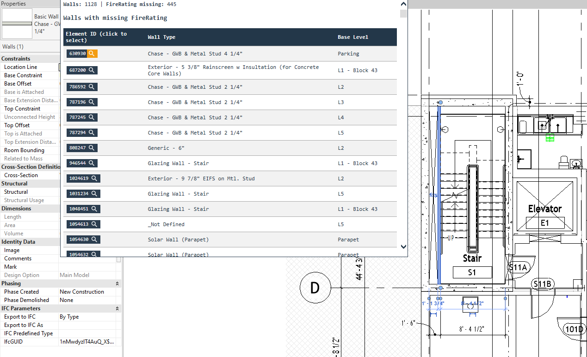
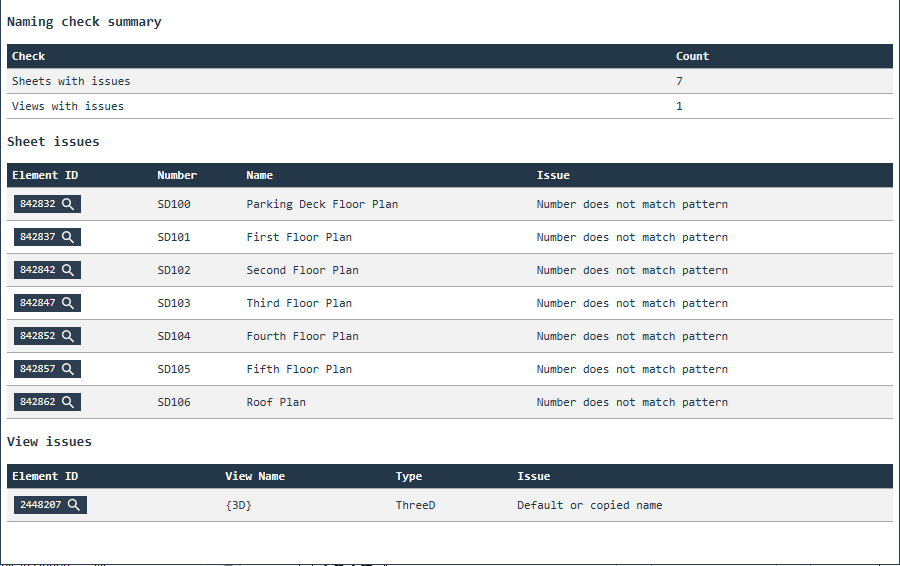

# BIM Checks for Revit and IFC

Small Python tools that check BIM models for missing data, for use by BIM coordinators.

## IFC checker (Python script)
`check_elements.py` reads an IFC model exported from Revit, checks walls, doors and windows for missing parameters (FireRating, IsExternal, LoadBearing) and writes `report.xlsx` with a summary sheet.

### Requirements
- Python 3
- `pip install ifcopenshell openpyxl`

### Usage
1. Export your Revit model as IFC (with "Export IFC common property sets" enabled)
2. Put the file next to the script and set its name in `IFC_FILE` at the top of the script
3. Run: `python check_elements.py`

## pyRevit extension
`BimTools.extension` adds a "Checks" tab to Revit with five read-only tools. They never change the model. Results open in a table with clickable element IDs, and most tools can export to CSV.

| Tool | What it checks |
|---|---|
| ElementCheck | Walls, doors and windows with a missing FireRating |
| ModelHealth | Warnings, imported CAD files, in-place families, views not on sheets |
| RoomCheck | Unplaced, unenclosed, unnamed and duplicate-number rooms |
| ParameterCheck | Pick categories and any parameter, list elements where it is empty |
| NamingCheck | Sheet numbers and view names against a configurable pattern |

### Install
1. Install [pyRevit](https://github.com/pyrevitlabs/pyRevit).
2. Put `BimTools.extension` in a folder, then in pyRevit Settings add that folder under Custom Extension Directories.
3. Click Save Settings and Reload.

